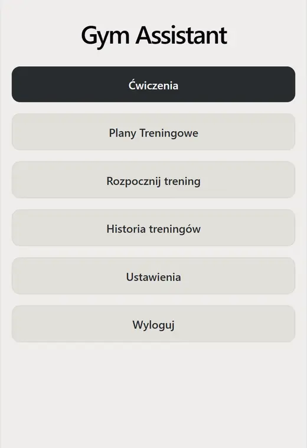
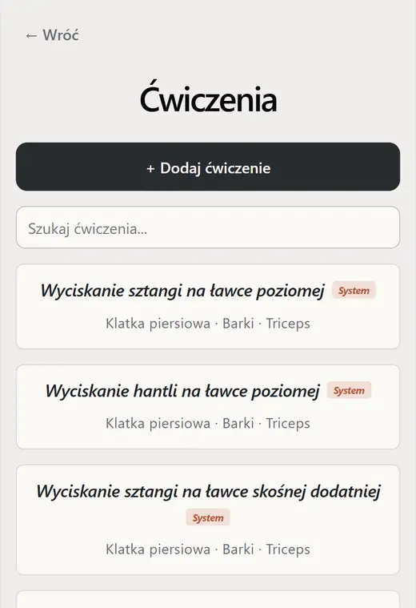
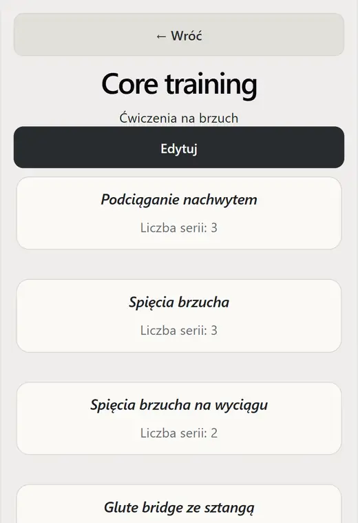
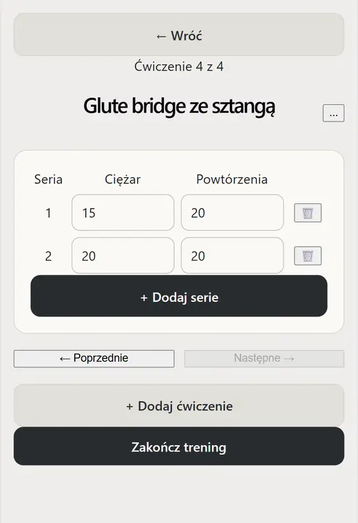
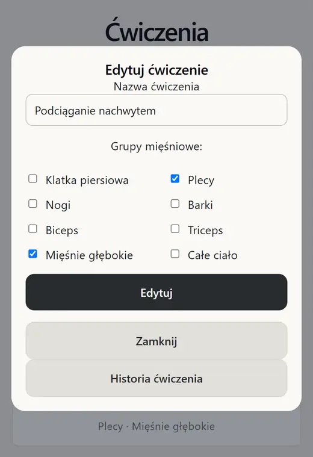

# GymAssistant

**A full-stack workout tracking application built with .NET 10 and React.**

GymAssistant helps users organize exercises, prepare workout templates, track sets during a training session, and review completed workouts. It is a personal portfolio project and is actively being developed.

> **Project status (21 November 2026):** v1.0 release preparation. GitHub Actions CI was reported green. The .NET 10 backend is deployed to Azure App Service, and Azure SQL is populated with 100 system exercises; registration, login and an authorized exercise-list request were manually verified against Azure. React is not deployed yet, so there is no public end-to-end web demo. Production SMTP, cookie/origin configuration, full smoke tests and security hardening remain open.

## Screenshots

The screenshots show the current mobile layout (UI labels are in Polish).

| Main menu | Exercise library | Workout template |
| :---: | :---: | :---: |
|  |  |  |

| Active workout | Edit exercise |
| :---: | :---: |
|  |  |

## Features

- **Exercise library:** browse system exercises, search exercises in the catalog and picker, and create or edit personal exercises with muscle-group assignments.
- **Workout templates:** create reusable training plans and adjust the included exercises and planned sets.
- **Workout sessions:** start from a template or build a session from scratch; record sets, weights and repetitions; resume an unfinished workout or discard it before starting another; add or remove exercises while the session is active.
- **Training history:** review completed workouts and exercise history (dates, sets, repetitions and weights); expand a workout from an exercise's history to see its exercise list and set counts. Details are fetched on demand and cached for the current page visit. Active and discarded sessions are excluded.
- **User accounts:** register, log in, reset a forgotten password using an email link (currently tested via local Mailpit), and access only your own templates, sessions, and private exercises. System exercises are shared and read-only.

## Tech stack

| Layer | Technologies |
| --- | --- |
| Backend | C#, .NET 10, ASP.NET Core Minimal APIs, Entity Framework Core 10 |
| Database | SQL Server (local), Azure SQL Database (deployment) |
| Frontend | React, TypeScript, Vite |
| Authentication | ASP.NET Core Identity, JWT access tokens, refresh-token rotation, reset tokens |
| Development email | MailKit SMTP + Mailpit (local testing only) |
| Testing | xUnit, `WebApplicationFactory`, SQLite in-memory integration tests |
| API reference | OpenAPI and Scalar in Development |
| Hosting (work in progress) | Azure App Service Linux F1, Azure SQL Database Serverless Free Offer; React hosting pending |
| CI | GitHub Actions: backend build/tests and frontend build (reported green, 18 November 2026) |

## Technical highlights

- **Authentication and session recovery:** short-lived JWT access tokens, refresh tokens stored as hashes in the database, `HttpOnly` refresh cookies, token rotation/revocation, and a centralized `401 → refresh → retry` flow.
- **Authorization:** user ownership enforced server-side for workout templates, sessions, and private exercises; system exercises remain accessible to all authenticated users.
- **Session lifecycle:** `FinishedAt` and `DiscardedAt` distinguish completed, abandoned and active workouts. The API exposes active-session lookup and idempotent discard, prevents a second active session, and blocks modifications to completed or discarded workouts.
- **Active workout save coordination and recovery:** a parent-owned in-flight guard prevents overlapping writes and temporarily disables controls. The current v1.1-in-progress interface separates the exercise list from set-entry details; locally edited sets are PATCHed on return to the list, and failed saves keep the details view open for retry. Finishing retains failed exercise writes for retry. Manual refresh reloads server data with confirmation before discarding unsaved local edits.
- **Integration testing:** real authenticated HTTP requests against a test host built with `WebApplicationFactory` and SQLite in-memory, including ownership and validation scenarios.

For implementation details, see [Authentication.md](Authentication.md) and [Api.md](Api.md).

## Getting started (local development)

**Prerequisites:** .NET 10 SDK, SQL Server, Node.js/npm, and the `dotnet-ef` tool (EF Core 10 compatible).

1. Clone this repository and configure a local SQL Server instance. Adjust `ConnectionStrings:DefaultConnection` as needed using local configuration or user secrets.
2. Configure a strong JWT signing key and a development-user password in ASP.NET Core user secrets (do not commit actual credentials):

   ```powershell
   dotnet user-secrets set "Jwt:SigningKey" "<a-random-secret-of-at-least-32-bytes>" --project backend/GymAssistant.Api/GymAssistant.Api.csproj
   dotnet user-secrets set "DevelopmentUser:Password" "<strong-local-password>" --project backend/GymAssistant.Api/GymAssistant.Api.csproj
   ```

3. Apply database migrations and start the API:

   ```powershell
   dotnet ef database update --project backend/GymAssistant.Api/GymAssistant.Api.csproj --startup-project backend/GymAssistant.Api/GymAssistant.Api.csproj
   dotnet run --project backend/GymAssistant.Api/GymAssistant.Api.csproj --launch-profile http
   ```

4. Create `frontend/.env.local` with the backend URL, then start the frontend:

   ```dotenv
   VITE_API_URL=http://localhost:5235
   ```

   ```powershell
   cd frontend
   npm ci
   npm run dev
   ```

The development frontend is configured for `http://localhost:5173`. The API's HTTP port is defined by its launch profile; update `VITE_API_URL` if yours differs. Local HTTPS/cookie behavior may require using the HTTPS launch profile and matching origins.

### Local password-reset email

Password reset uses MailKit SMTP, with Mailpit as the local test inbox. With Docker Desktop running, start Mailpit:

```powershell
docker run -d --name mailpit -p 127.0.0.1:8025:8025 -p 127.0.0.1:1025:1025 axllent/mailpit
```

The API's `appsettings.Development.json` configures `Smtp:Host=localhost`, `Smtp:Port=1025` and a local-only sender address. Browse `http://localhost:8025` to see reset messages. Use an email that belongs to an Identity user in the local database; Mailpit captures that message even if no real mailbox exists.

The reset URL points to the frontend origin configured by `Frontend:Origin`. Production delivery is **not yet configured**: a real SMTP provider, secure transport, credentials via secrets/environment and abuse protection are required before public release. Do not commit real SMTP passwords or tokens.

### Integration tests

```powershell
dotnet test backend/GymAssistant.sln
```

## Azure deployment status (21 November 2026)

- **App Service:** `gymassistant-api`, Linux / .NET 10, Free F1, manual ZIP deployment. Free F1 is being evaluated for reliability and may need an upgrade; no automated CD is configured.
- **Azure SQL:** `GymAssistantDb` on logical server `gymassistant-sql-prod` (Poland Central), Serverless Free Offer, overage billing disabled. Eight EF Core migrations were applied through an idempotent SQL script using SSMS; the system exercise SQL seed inserted 100 exercises. These are new production data, not copied development users or workouts.
- **Database auth:** system-assigned Managed Identity for the App Service, mapped to a contained Azure SQL user with `db_datareader` and `db_datawriter` roles. Schema migrations were executed separately with an Entra admin; the application identity does not have schema-owner permissions.
- **Configuration:** `ASPNETCORE_ENVIRONMENT=Production`, `Jwt__SigningKey`, and Azure connection string are configured in App Service. Secrets must never be committed. The React origin and real SMTP delivery are not yet production-configured.
- **Manual smoke tests:** unauthenticated exercise GET returned 401; registration initially timed out during SQL post-login but succeeded on retry; login and an authorized exercise GET subsequently succeeded, returning seeded exercise records. `EnableRetryOnFailure()` was added locally and a ZIP redeploy was initiated/reported, but its final verification remains open.
- **Next steps:** verify latest API redeploy, remove the temporary SQL firewall rule for the cafe IP if still present, omit `appsettings.Development.json` from future publish artifacts, deploy React (Azure Static Web Apps), set `VITE_API_URL` and `Frontend__Origin`, resolve cross-site refresh-cookie/CORS behavior, configure production SMTP, and run full end-to-end smoke tests. Azure budget/alerts and cost verification should also be confirmed.

See [release checklist](todo.md) for outstanding deployment and QA items.

## Documentation and roadmap

- [API reference](Api.md) — endpoints, request/response examples, and authorization rules.
- [Authentication design](Authentication.md) — login, refresh, logout, token storage, and authorization flow.
- [Development notes and outstanding tasks](todo.md) — current implementation checklist and known issues.

**Known work in progress:** the active-workout list/details UI refactor requires regression verification and restoration or replacement of the previous horizontal swipe gesture; consistent API error presentation across screens and a backend error contract, guarding against unsaved changes when leaving the workout screen, mobile gesture edge cases, thorough failure-path testing and additional integration tests, and final review of production authentication configuration. This repository demonstrates the current implementation rather than a production-ready service.
