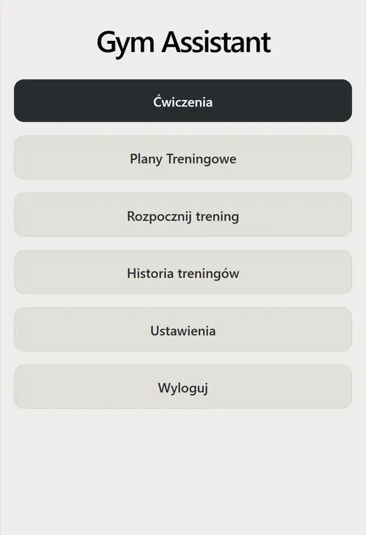
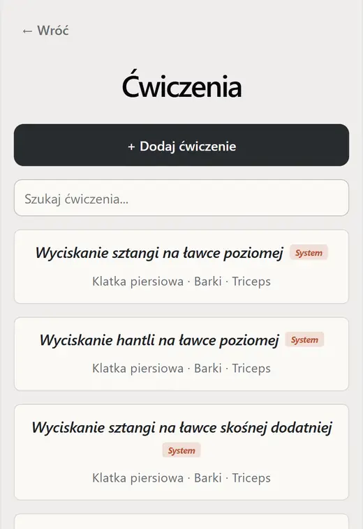
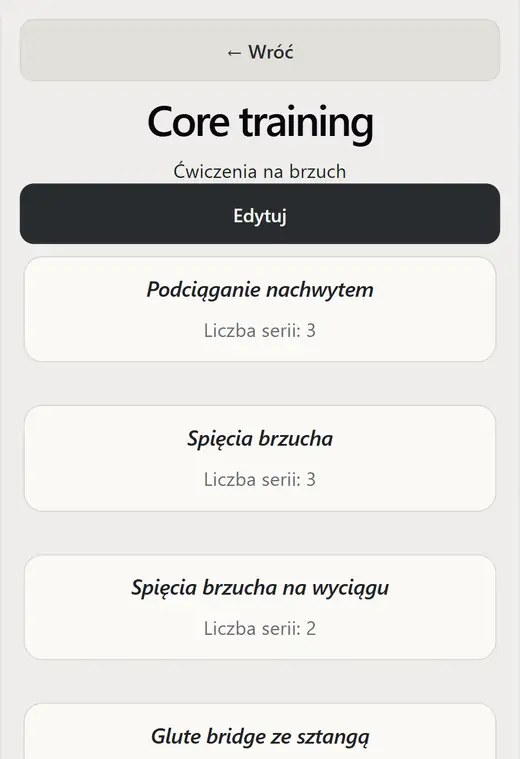
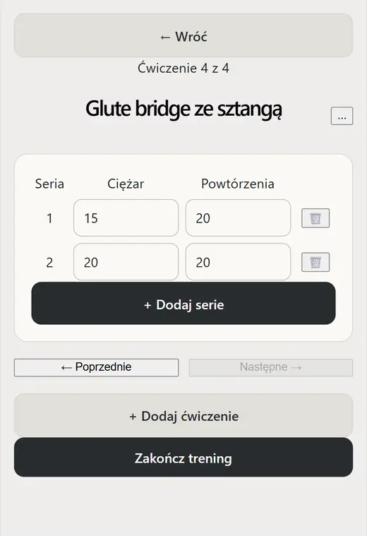
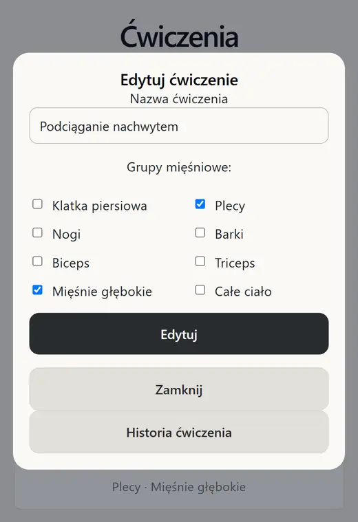

# GymAssistant

**A full-stack workout tracking application built with .NET 9 and React.**

GymAssistant helps users organize exercises, prepare workout templates, track sets during a training session, and review completed workouts. It is a personal portfolio project and is actively being developed.

> **Project status:** Work in progress. The core workout flows and authentication are implemented; the UI, automated test coverage, and production-readiness are still being improved. There is currently no public hosted demo.

## Screenshots

The screenshots show the current mobile layout (UI labels are in Polish).

| Main menu | Exercise library | Workout template |
| :---: | :---: | :---: |
|  |  |  |

| Active workout | Edit exercise |
| :---: | :---: |
|  |  |

## Features

- **Exercise library:** browse system exercises, search the catalog, and create or edit personal exercises with muscle-group assignments.
- **Workout templates:** create reusable training plans and adjust the included exercises and planned sets.
- **Workout sessions:** start a session from a template or build one from scratch; record sets, weights, and repetitions; add or remove exercises while the session is active.
- **Training history:** finish workouts and review previous sessions and exercise history.
- **User accounts:** register, log in, and access only your own templates, sessions, and private exercises. System exercises are shared and read-only.

## Tech stack

| Layer | Technologies |
| --- | --- |
| Backend | C#, .NET 9, ASP.NET Core Minimal APIs, Entity Framework Core |
| Database | SQL Server |
| Frontend | React, TypeScript, Vite |
| Authentication | ASP.NET Core Identity, JWT access tokens, refresh-token rotation |
| Testing | xUnit, `WebApplicationFactory`, SQLite in-memory integration tests |
| API reference | OpenAPI and Scalar in Development |

## Technical highlights

- **Authentication and session recovery:** short-lived JWT access tokens, refresh tokens stored as hashes in the database, `HttpOnly` refresh cookies, token rotation/revocation, and a centralized `401 → refresh → retry` flow.
- **Authorization:** user ownership enforced server-side for workout templates, sessions, and private exercises; system exercises remain accessible to all authenticated users.
- **Session lifecycle:** backend rules prevent modifications to completed sessions and validate exercise/set operations.
- **Integration testing:** real authenticated HTTP requests against a test host built with `WebApplicationFactory` and SQLite in-memory, including ownership and validation scenarios.

For implementation details, see [Authentication.md](Authentication.md) and [Api.md](Api.md).

## Getting started (local development)

**Prerequisites:** .NET 9 SDK, SQL Server, Node.js/npm, and the `dotnet-ef` tool (EF Core 9 compatible).

1. Clone this repository and configure a local SQL Server instance. Adjust `ConnectionStrings:DefaultConnection` as needed using local configuration or user secrets.
2. Configure a strong JWT signing key and a development-user password in ASP.NET Core user secrets (do not commit actual credentials):

   ```powershell
   dotnet user-secrets set "Jwt:SigningKey" "<a-random-secret-of-at-least-32-bytes>" --project backend/GymAssistant.Api/GymAssistant.Api.csproj
   dotnet user-secrets set "DevelopmentUser:Password" "<strong-local-password>" --project backend/GymAssistant.Api/GymAssistant.Api.csproj
   ```

3. Apply database migrations and start the API:

   ```powershell
   dotnet ef database update --project backend/GymAssistant.Api/GymAssistant.Api.csproj --startup-project backend/GymAssistant.Api/GymAssistant.Api.csproj
   dotnet run --project backend/GymAssistant.Api/GymAssistant.Api.csproj --launch-profile http
   ```

4. Create `frontend/.env.local` with the backend URL, then start the frontend:

   ```dotenv
   VITE_API_URL=http://localhost:5235
   ```

   ```powershell
   cd frontend
   npm ci
   npm run dev
   ```

The development frontend is configured for `http://localhost:5173`. The API's HTTP port is defined by its launch profile; update `VITE_API_URL` if yours differs. Local HTTPS/cookie behavior may require using the HTTPS launch profile and matching origins.

### Integration tests

```powershell
dotnet test backend/GymAssistant.sln
```

## Documentation and roadmap

- [API reference](Api.md) — endpoints, request/response examples, and authorization rules.
- [Authentication design](Authentication.md) — login, refresh, logout, token storage, and authorization flow.
- [Development notes and outstanding tasks](todo.md) — current implementation checklist and known issues.

**Known work in progress:** mobile gesture edge cases and navigation races, additional integration tests, and final review of production authentication configuration. This repository demonstrates the current implementation rather than a production-ready service.
